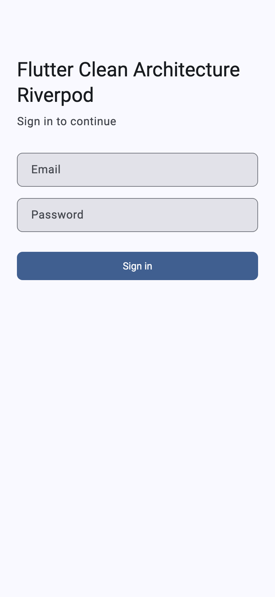
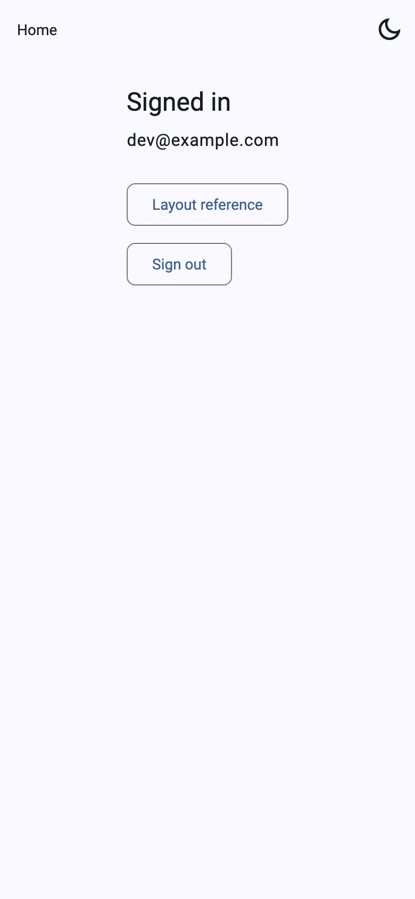
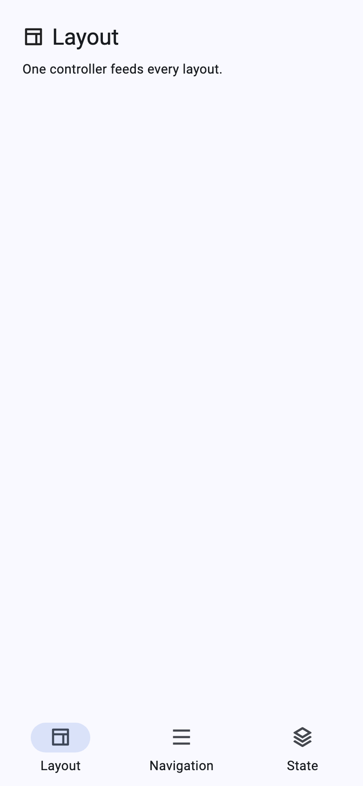
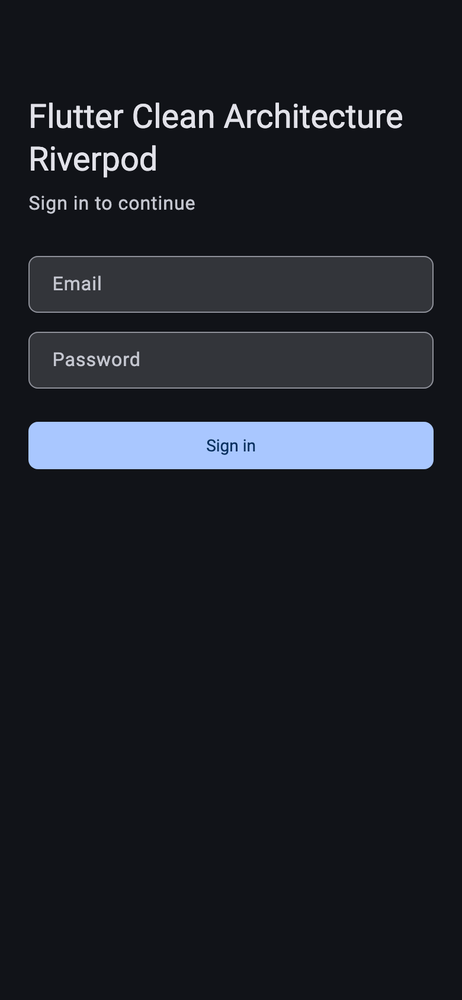
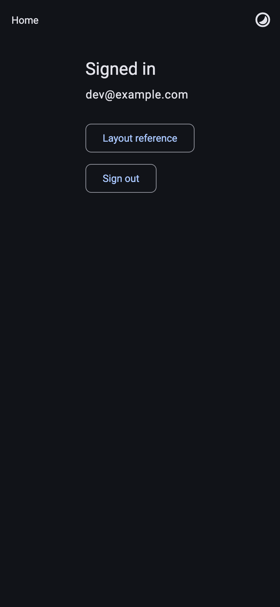
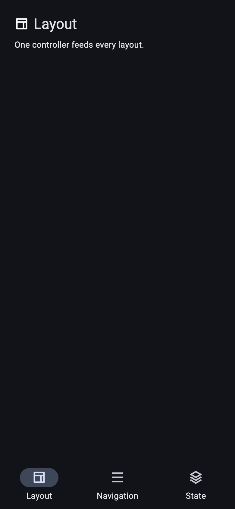

<!-- identity:start -->
# Flutter Clean Architecture Riverpod

- Package name: `flutter_clean_architecture_riverpod`
- Display name: Flutter Clean Architecture Riverpod
- Bundle id: `com.flutter.cleanarchitectureriverpod`
<!-- identity:end -->

[](https://github.com/bayajitislam/flutter_clean_architecture_riverpod/actions/workflows/ci.yml)

**Flutter clean architecture starter with Riverpod** — a production-ready Flutter boilerplate for feature-first clean architecture, GoRouter, Dio, Freezed, theming, and a CLI (`fcar`) that creates independent apps.

Use it as a Flutter template, Riverpod starter kit, or clean architecture boilerplate. Fork it, generate a new app, and ship without rebuilding the stack.

It is meant to be forked and improved in public. Coding agents and humans share the same rules in `.agent/rules/` (see [Agent rules](#agent-rules) below). Longer explanations live in `docs/`.

## Screenshots

| Login | Home | Showcase |
| --- | --- | --- |
|  |  |  |
|  |  |  |

Regenerate with `flutter test test/widget/screenshot_capture_test.dart --update-goldens`.

## Key features

- Feature modules with data, domain, and presentation boundaries, checked by `fcar validate`.
- Auth flow with a fake source for local development and a Dio source when an API URL is set.
- Light, dark, and system themes from one brand color.
- Responsive layouts, with one reference feature that has separate mobile, tablet, and desktop screens.
- A CLI (`fcar`) to create a project, rename it, generate a feature, and validate the layout.

## Architecture

Presentation calls use cases. Use cases call a repository contract. The data layer implements the repository and returns `Result<T>`. Domain code does not import Flutter or Dio. Screens do not call Dio.

```text
lib/
  main.dart
  app.dart
  core/          network, storage, theme, routing, shared controls
  features/      auth, home, showcase
  shared/        widgets and breakpoints used by more than one feature
tool/            create, rename, feature, validate
test/unit
test/widget
```

The full tour is in [docs/architecture/overview.md](docs/architecture/overview.md). Decisions are in [docs/decisions](docs/decisions).

## Stack

- Flutter and Dart (`sdk: ^3.12.2`)
- Riverpod for state and dependency injection
- GoRouter for navigation
- Dio, behind one shared client
- Freezed and json_serializable for models and suitable state
- Flutter Secure Storage for tokens
- SharedPreferences for theme and other simple preferences
- flutter_devlog, through `AppLogger`
- `material_ui` for Material widgets (not `package:flutter/material.dart`)
- Remix Icon, through `AppIcons`, which also exposes Material `Icons`

Why these packages were chosen is in [docs/architecture/dependencies.md](docs/architecture/dependencies.md). Why Riverpod instead of Bloc, Provider, or GetX is in [docs/decisions/0002-riverpod.md](docs/decisions/0002-riverpod.md).

### Why `material_ui`?

Flutter is splitting Material out of the SDK. On current stable, `package:flutter/material.dart` is deprecated and `flutter analyze` fails when you keep importing it. This starter depends on the official [`material_ui`](https://pub.dev/packages/material_ui) package (`^1.x`) and imports `package:material_ui/material_ui.dart` everywhere UI code needs Material. Domain code still must not import it. The decision record is [docs/decisions/0008-material-ui.md](docs/decisions/0008-material-ui.md).

Firebase, Drift, RevenueCat, localization, and offline caching are not installed. Add one only when a project needs it.

## Getting started

Install Flutter on the stable channel so that `dart --version` satisfies the SDK constraint in `pubspec.yaml`.

```bash
git clone https://github.com/bayajitislam/flutter_clean_architecture_riverpod.git
cd flutter_clean_architecture_riverpod
flutter pub get
cp env/dev.json.example env/dev.json
flutter run --dart-define-from-file=env/dev.json
```

An empty `API_BASE_URL` uses the fake auth source. Any valid email and a password of at least 8 characters signs you in.

## Environments

| Flavor | File | API URL |
| --- | --- | --- |
| Development | `env/dev.json` | Optional. Empty uses fake auth. |
| Staging | `env/staging.json` | Required. Startup throws if it is empty. |
| Production | `env/prod.json` | Required. Startup throws if it is empty. |

```bash
flutter run --dart-define-from-file=env/staging.json
flutter build apk --dart-define-from-file=env/prod.json
flutter build web --dart-define-from-file=env/prod.json
```

Copy the matching `*.json.example` file. The examples contain placeholders only. Real URLs stay in the untracked JSON file. `FLAVOR` must be `dev`, `staging`, or `prod`.

## Creating a feature

```bash
dart run :fcar feature create products
```

Register the screen in `lib/core/routing/app_router.dart`. The remote source throws `UnimplementedError` until an endpoint exists. Pass `--presentation-only` for a screen with no data layer. Pass `--dry-run` to print the file list.

How widgets, screens, and further commands should be added is in [docs/guides/extending.md](docs/guides/extending.md).

## Responsive UI

Width comes from the available layout, not from the operating system. Tablet starts at 600 logical pixels and desktop at 1024. Login and home use one responsive body. The showcase screen at `/showcase` is the reference for separate mobile, tablet, and desktop layouts that share one controller.

Do not create three screens unless the layouts are actually different.

## Theme

Change `AppColors.brand` to recolor light and dark mode. Typography, spacing, and radius have their own files under `lib/core/theme`. Success, warning, border, and disabled colors are `AppStatusColors`.

The app stores light, dark, or system in shared preferences. System mode follows the device. Screens read `context.colors`, `context.textTheme`, and `context.statusColors`.

## CLI

`dart run tool/fcar.dart`, `dart run :fcar`, and `dart run tool/cli.dart` run the same commands.

```bash
dart run tool/fcar.dart create my_shop
dart run tool/fcar.dart init my_shop
dart run :fcar feature create products
dart run :fcar validate
```

`create` writes an independent application next to this repository. It does not modify this starter. The new app gets its own README and docs. The showcase is left out unless you pass `--showcase`. Sample sign-in stays unless you pass `--no-auth`.

`init` is the GitHub template step. Mark this repository as a template, create a new repository from it, clone that repository, and run `init` there. Do not run `init` here if you still want this checkout to stay the starter kit.

Details, defaults, and the file split are in [docs/guides/handoff.md](docs/guides/handoff.md).

`rename` edits known identity fields. It does not rewrite signing configs, Firebase files, entitlements, or URL schemes.

`validate` checks layout, identity, imports, env examples, and generated-part directives. It exits with code 1 when the check fails.

`dart pub global activate --source path .` puts `fcar` on your PATH. This package sets `publish_to: none` because it is a template, not a package published to pub.dev.

## Testing

```bash
dart format .
flutter analyze
flutter test
dart run :fcar validate
```

Unit tests live in `test/unit`. Widget tests live in `test/widget`. `test/integration` is reserved for a device flow. CLI tests use temporary directories and do not rename this checkout.

CI runs format, analysis, tests, `validate`, a code-generation diff, and `flutter build web`.

## Contributing

Read [CONTRIBUTING.md](CONTRIBUTING.md) before opening a pull request. Behavior toward other people is described in [CODE_OF_CONDUCT.md](CODE_OF_CONDUCT.md). Report a vulnerability in private, as [SECURITY.md](SECURITY.md) describes. Do not open a public issue for a security report.

[AGENTS.md](AGENTS.md) is the instruction file for coding agents. It points at `.agent/rules/` and `.agent/workflows/`.

## Agent rules

`.agent/rules/` holds the same conventions humans and agents should follow (architecture, UI, generation, testing). `.agent/workflows/` has short task recipes such as adding a feature.

- **Cursor / Copilot:** Point the agent at `AGENTS.md` (already at the repo root). Rules under `.agent/rules/` are the detailed source of truth for edits.
- **Claude Code:** Load `AGENTS.md` and the matching file in `.agent/rules/` before changing a feature. Use `.agent/workflows/new_feature.md` when scaffolding.
- Do not invent a second stack. The rules forbid a second state manager, router, or HTTP client.

## License

MIT. See [LICENSE](LICENSE). Copyright (c) 2026 Bayajit Islam. Third-party packages keep their own licenses. See [docs/architecture/dependencies.md](docs/architecture/dependencies.md).

## Roadmap

These are gaps, not promised dates:

- Integration tests when a flow needs a device. The folder `test/integration` is reserved for that.
- Optional product modules, such as localization or offline storage, only after a real caller needs them.

Release numbering is described in [docs/guides/releasing.md](docs/guides/releasing.md). Tagged releases start at `v0.1.0`.

## Acknowledgments

The starter is built with Flutter and the packages listed above. Remix glyphs come from the `remixicon` package. No contributor list is published here, because this file does not invent one.
